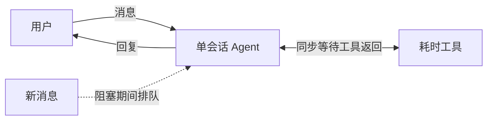
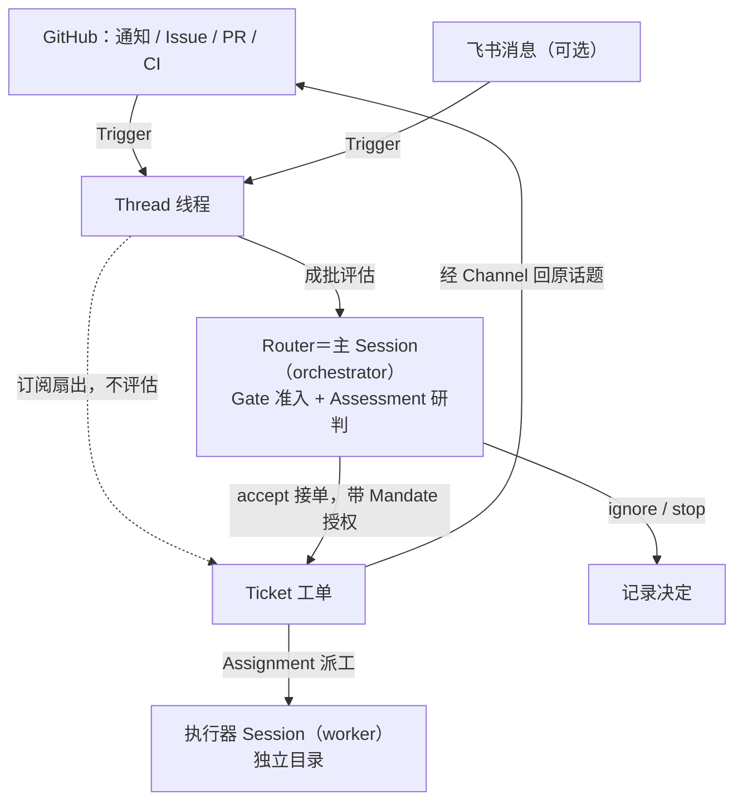
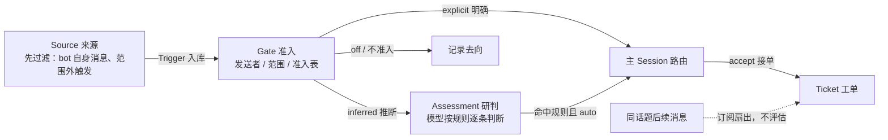
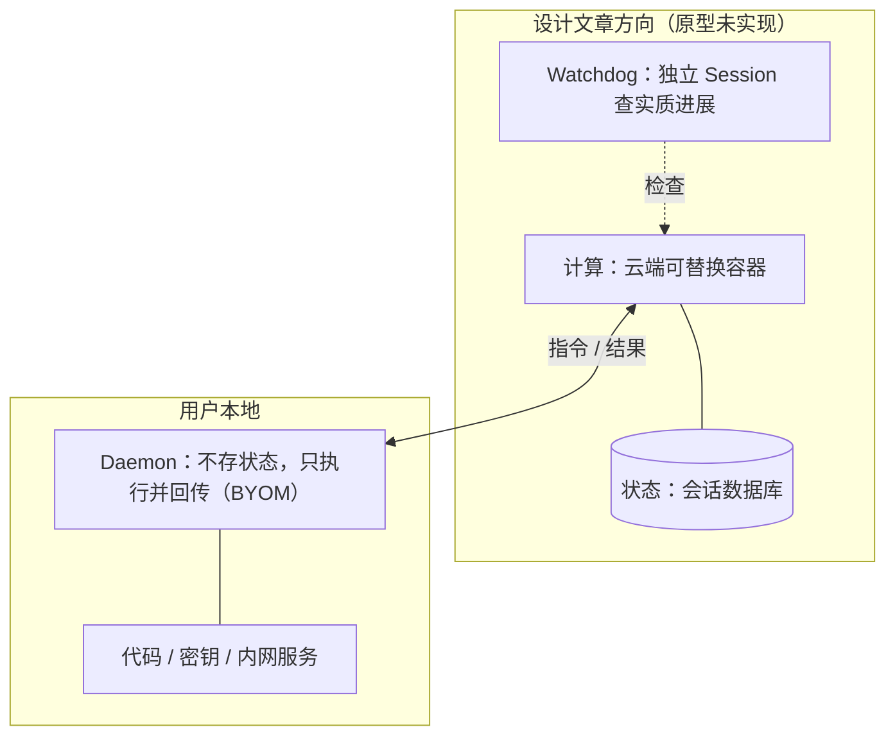

> [!NOTE] 提示
> 核心思路：把单个 Agent 扩展成「Router 调度 + Worker 执行」的两层团队，由环境事件驱动，按需恢复上下文，实现跨渠道、多任务并行、持续在线。本文由 AI 调研学习整理，以开源原型仓库为一手来源，参考设计文章与公开报道，区分原型已实现与设计方向，供学习参考。

## 背景知识

主流编码 Agent（Claude Code、Codex、DeepSeek Harness）以一个 Session 为单位跑 ReAct 循环：思考下一步、执行工具、观察结果、再决定。单任务够用，直接接到飞书、GitHub 这类外部渠道时出三个问题：

- 耗时命令阻塞整条循环，期间的新消息只能排队；
- 多个需求混进同一个上下文，互相干扰；
- Agent 跑在本地电脑上，休眠或关机任务就停。

把 Agent 接进渠道和仓库这件事，业界已有几个产品，取舍各不相同：

| 产品 | 形态 | 与 Super Agent 的差异 |
|------|------|----------------------|
| Grok Bot（xAI，2026-08） | 一组常驻云端电脑的 Agent，在 X、Telegram 等应用里全天候接活，长任务主动推进 | 定位最接近：常驻、主动、多应用；不聚焦编码工作流，没有工单与授权模型 |
| GitHub Copilot coding agent | 在 Issue 下指派任务，自动开分支提 PR | 同为单仓库事件驱动；只响应被指派的任务，没有群聊准入和跨渠道上下文 |
| OpenAI Codex（云端） | 并行多任务，可从 Slack、GitHub 派活 | 云端并行执行相近；任务间上下文隔离，同一话题跨渠道的连续性弱 |
| Devin（Cognition） | Slack 里派活的自主工程师 | 入口形态类似；准入、授权、审计未成体系 |
| Google Jules | 异步编码 Agent，云端 VM 跑完交 PR | 同为异步执行；没有订阅直通与分层准入 |

Super Agent 的四个设计目标（来源：设计文章）：

| 特征 | 含义 | 靠什么实现 |
|------|------|-----------|
| 连续 Continuous | 在飞书群、GitHub、PR 之间切换讨论同一件事，Agent 跟得上上下文 | Router 维护全局上下文 |
| 高效 Efficient | 一个任务未完成时仍能接收并推进其他任务 | 多工单并行、上下文隔离 |
| 主动 Proactive | 持续观察群消息、PR 评论、CI 结果，识别值得处理的事项 | 事件驱动 + 两层准入 |
| 持久 Persistent | 长时间在线，异常后自行恢复 | 状态持久化 + 恢复机制 |

原型 dsh-superagent 的定位（README）：

- 面向单个 GitHub 仓库（可选接飞书）的主动式编码 Agent，打包成 DeepSeek Harness 插件；
- 监听事件、开工单、在独立 Session 和目录里干活、回原对话；
- Web 面板只列出需要人处理的事；
- 核心原则：尽可能少占用人的注意力，尽可能多交付价值。只在被要求或团队规则允许时行动，只在有人必须行动或能用上结果时说话。

## 双层架构

设计文章称 Router / Worker；原型代码里叫 orchestrator / worker，文档中文叫主 Session / 执行器 Session。下文用 Router 和执行器，读仓库时按括号里的名字对应。

- **Router（主 Session，orchestrator）**：统一入口。接收各渠道消息、维护全局上下文、评估触发、分派任务、汇总结果并对外沟通。不亲自执行耗时工作，可以用较轻量的模型；原型里评估模型与执行模型分开配置。
- **执行器（Worker，worker）**：每个工单一个独立 Session 和目录，完成后向 Router 汇报，不直接面对用户。复杂任务可再调 Subagent，相当于工程师带实习生。

Router 靠批处理消化消息洪峰：

- 规则：一个 Thread 同时只跑一个 Eval，评估期间到达的 Trigger 并入下一批；
- 压测（设计文章，合成负载）：Trigger 从约 1 条/分钟升到 40 条/分钟时，平均批大小 1.0 → 2.8，单次请求 2.5 s → 3.9 s，单个决策分摊推理 6.4 s → 1.6 s；
- 结论：消息越密，摊薄效应越明显。

读仓库用的术语对照：

| 通行叫法 | 原型文档 | 代码 | 含义 |
|---------|---------|------|------|
| Router | 主 Session | orchestrator | 接入、评估、分派、沟通 |
| Worker | 执行器 Session | worker | 单工单执行 |
| 工单 | Ticket | Ticket | 一单位被授权的工作 |
| 授权 | Mandate | Mandate | accept 授予的范围与强度 |
| 门卫 Fast Path | Gate 准入 | gate | 确定性第一层 |
| 秘书 Slow Path | Assessment 研判 | assessment | 模型判断层 |

## 事件驱动

传统 Agent 是「用户说一句，Agent 做一次」；Super Agent 由环境事件驱动。群聊消息、PR 评论、构建失败、工单状态变化统称 Trigger；同一个 IM 话题或同一个 PR 下的连续 Trigger 构成一条 Thread。

原型 002 号文档把 Trigger 的去向分成两条路径，这是整套设计最核心的部分。

评估路径决定是否开工。群聊里大部分消息与工作无关，逐条丢给大模型判断太贵，所以先过确定性代码：

- **Gate（准入）**：确定性代码，只看发送者身份、接收范围和准入表。允许列表里的人点名 Agent 是 explicit（明确）请求；列表外的消息或 bot 最多算 inferred（推断）候选。
- **Assessment（研判）**：模型按团队写的规则逐条判断，只有命中规则且模式为 auto 才真正接单。

主动接单三种模式：

- off：推断事件不生成候选；
- observe（默认）：积极研判只记录为「本会接受」的忽略；
- auto：命中规则才建工单；
- 明确请求在三种模式下都处理。准入表按接收范围（每个群、每种 GitHub 事件）逐行配置 explicit / inferred / ignore。

直通路径续接已有工作：

- 工单订阅 Thread 后，同话题后续消息经扇出直达执行器，完全绕过评估，也不授予新权限，每个工单仍受自己的 Mandate 约束；
- 结束的工单被人的消息原样复活（同一 Mandate，无需新评估）；bot 和 CI 的消息唤醒不了它。

Mandate（授权）的规则：

- 生命周期只有三种变化：accept 创建、人的 stop 撤销、复活前重新校验失败吊销；
- 范围扩大要开新工单：「复现并提出修复」不含「合并所有 PR」；
- 策略有版本号：变更丢弃运行中的评估并通知受影响工单，但不立即吊销已授的权；
- 安全边界（002 文档）：宿主程序强制执行允许列表、规则和 Mandate，消息、评论和引用的文档只是判断的输入，改不了这些权限。

设计文章的两条补充：

- 消融实验：去掉直通后任务完成时间基本不变，Router 决定数增加约 30%，直通省的主要是 Router 的算力和 Token；
- 主动场景：群里提出「正文、代码、终端字体需要分别配置」，Agent 自行到 GitHub 提交修改，按追问和维护者建议迭代到合并；从产品用户群识别 Bug，后台复现定位根因，发出修复代码和前后对比截图。

## 执行器

每个工单拿到名为 `worker-<工单号>` 的 Session 和一个独立目录，目录由 prepare 命令准备，典型做法是 git worktree 检出。

半双工到全双工的机制：

- 执行器预设把前台 shell 命令 5 秒后转入后台作业，结果在下一步送达，长命令不再阻塞收新消息；
- Router 预设更严格：noWait 守卫直接拒绝 sleep、超过 30 s 的前台命令和超过 5 s 的作业等待，理由是「等待只会拖延进来的候选」；
- 术语归纳（视频解读）：同步 ReAct 是半双工，这套后台化是全双工方向；设计文章描述的 `start()` / `stop()` 异步机制已在 DeepSeek Harness 实现，未默认开启；
- 多信道由 Channel 承担：GitHub 评论、PR 评审回复、飞书话题回复，永远回原讨论串。

并发限制：

- maxWorkers 可配 1~16 个工单槽位，另给人的消息和状态请求留一个额外槽位，新任务挤不掉人；
- 后台作业每轮上限 30 分钟，超时杀掉并报告等待。

工单阶段由面板直观呈现：working（执行中）、queued（排队）、idle（等触发）、person/answer（等人答复）、person/review（等审查）、blocked、failed。执行器的报告只有六种值：progress、waiting、ready、blocked、failed、dropped。

自动合并护栏（默认提示词）：

- 不用 agent 账号开自动合并，GitHub 会把合并记到开启者头上；
- 仅当 PR 属于本工单、状态 ready、所需审批覆盖最新提交、且增删行数合计少于 200 行时才允许；
- 推新版本前先撤回自动合并。

## 上下文管理

设计文章借用编译器概念：

- Inline：近期要用的信息内联进上下文；
- Spill：超出预算的低频内容外置成摘要加编号，需要时按 id 回查。

原型给出的预算数字（评估一条推断候选时）：

- Trigger 文本最多 4,000 字符；
- 相关工单最多 8 个；
- Thread 窗口：首 5 条加触发消息前后各 5 条，每条 400 字符，相邻两条 1,200；
- 窗口外消息只给 50 字符的 stub，模型用 `orchestrator_eval_read` 按 id 展开原文；
- 读资源的页默认 4,000 字符、上限 8,000。

原型的要求是页面上出现的每个 id 都能走通到下一个对象，Router 沿编号逐层召回，完整记录不常驻上下文。

## 持久化

原型现状是单机：

- 一个 SQLite 文件（orchestrator.sqlite）存全部 Trigger、Thread、工单和决定，目录锁防止第二个进程写；
- 写入遵循「先存储后执行」：回复、派工、投递都先进 Outbox 和 Effects 持久队列，失败从 2 s（回复 5 s）起指数退避重试；
- 重启后有恢复说明，告诉执行器先检查目录、git 历史和 GitHub，再决定是否重复外部动作；Source 的读取位置和未读消息都保留；
- 进程级看门狗是文档建议的小时检查：在另一个 profile 里每小时跑一次 status，退出码 1 就自动重启，2 和 3 上报人。

设计文章的目标形态（原型未实现）：

- 计算放云端可替换容器、会话状态入库，容器故障换一个即可；
- 代码、密钥和内网服务留在用户设备，本地只装不存状态的 Daemon（守护进程），执行云端指令并回传结果，即 BYOM（Bring Your Own Machine）；
- 独立的 Watchdog Session：用模型判断任务是否有实质进展，发现原地循环就介入修复；
- 投机执行：收到会议邀请先查冲突、备资料、写草稿，确认后发送；原型的 observe 模式只记录「本会做什么」。

## 落地注意事项

1. **执行环境不是沙箱**：两个预设以 danger-full-access 跑在操作者的 OS 用户下，凭据包装器只负责选账号，不隔离进程；worker 可以按路径执行任意程序、读操作者主目录。官方建议给 Agent 一个只含它自己凭据的专用 OS 账号。
2. **权限由宿主强制，风险在内容**：准入、Mandate、执行变量都由宿主程序强制，发给 Session 的文本改不了配置；但消息内容可以诱导模型（提示词注入），设计文章把它列为待解决的 P0 风险。
3. **运营纪律（README 给操作者的要求）**：从小允许名单和 observe 模式开始，看到「本会接受」的记录靠谱再切 auto；Agent 吵就改提示词或暂停，不加消息解释噪音；不用它刷量；它以团队账号发言，你要为它说的话负责。
4. **未解决的问题**：设计文章列了 Router 扩展性、跨月长程记忆、人机协作界面、A2A 通信和安全隐私；原型自己承认两处开放：Trigger 字段的信任边界（actor 与 Thread 归属可信，正文和引用不可信）、部署隔离；另外记录只增不删，长期运行要自己做清理。

## 总结

Super Agent 的「Super」在系统层面：持续协调多任务、跨渠道保持关系、适时主动推进，单个模型的推理能力没变。变化的是结构：Session 从工作单位降级成内部实现细节，协调工作从人转移到 Router，衡量一切的单位是人的注意力。这套设计更像把成熟的项目管理方法迁移到 AI 系统，而不是把一个模型做得更强。

代价同样明确：多会话读缓存 Token 高于单会话，官方的定性结论是用 Token 换更短、更稳的完成时间；安全面随主动性扩大，Router 扩展性和长程记忆仍是开放问题。想深读的读者，原型仓库的 000 到 003 号文档是全文最扎实的部分：领域模型、授权和执行的规则密度远高于一般开源项目。

## 参考资料

- [deepseek-ai/dsh-superagent-prototype（GitHub，官方研究原型，本文一手来源，含 000~008 号文档）](https://github.com/deepseek-ai/dsh-superagent-prototype)
- [CSDN：DeepSeek Super-agent 技术拆解（设计设想与原型能力对比）](https://devpress.csdn.net/aibjcy/6ae8417440858c2d8817eff1.html)
- [Yao et al. ReAct: Synergizing Reasoning and Acting in Language Models（ICLR 2023，arXiv 2210.03629）](https://arxiv.org/abs/2210.03629)（背景知识里 ReAct 循环的出处）
- [Packer et al. MemGPT: Towards LLMs as Operating Systems（arXiv 2310.08560）](https://arxiv.org/abs/2310.08560)（主上下文加外部存储的分层记忆，Inline/Spill 的同源思路）
- [Hong et al. MetaGPT: Meta Programming for a Multi-Agent Collaborative Framework（ICLR 2024，arXiv 2308.00352）](https://arxiv.org/abs/2308.00352)（把标准作业流程与多角色分工引入多智能体，与 Router-Worker 的团队化思路同向）
- [Park et al. Generative Agents: Interactive Simulacra of Human Behavior（UIST 2023，arXiv 2304.03442）](https://arxiv.org/abs/2304.03442)（记忆流、反思与主动计划，主动性的早期参照）
- [Yang et al. SWE-agent: Agent-Computer Interfaces Enable Automated Software Engineering（NeurIPS 2024，arXiv 2405.15793）](https://arxiv.org/abs/2405.15793)（编码 Agent 与执行环境接口设计）
- [Greshake et al. More than you've asked for: A Comprehensive Analysis of Novel Prompt Injection Threats to Application-Integrated Large Language Models（arXiv 2302.12173）](https://arxiv.org/abs/2302.12173)（间接提示词注入的系统分析，对应落地注意事项里的 P0 风险）
